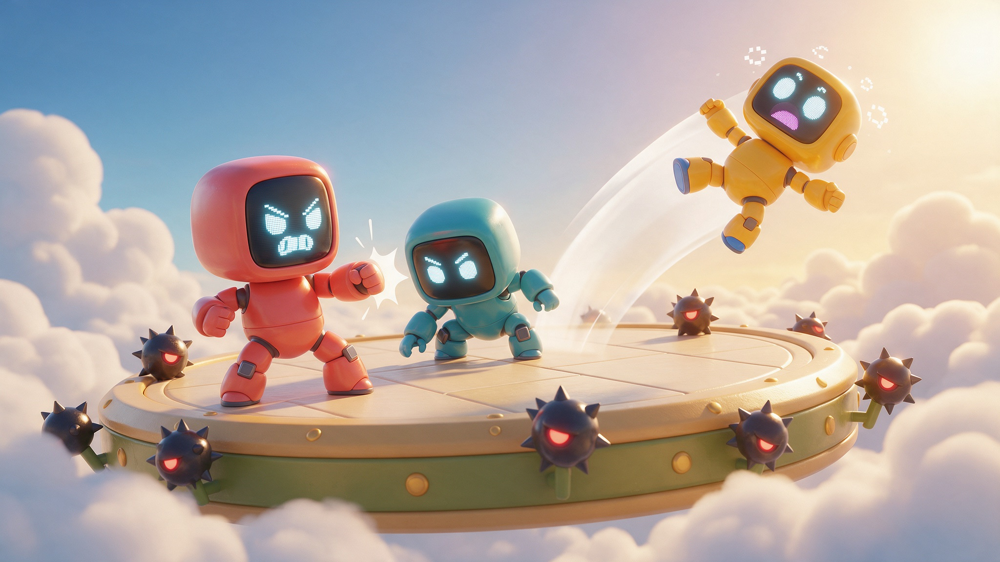

# 3D LAN Multiplayer Starter

A working multiplayer setup you can copy: host, join, and knock each other around a 3D arena as little robots.

This repo is a standalone copy of the `robot_war` networking demo from GDQuest's open-source mini-games collection, adapted for Summer Engine. It launches straight into `res://networking/robot_war/robot_war.tscn`.

## What's inside

- ENet networking wired end to end: host, join by IP, spawn and replicate players.
- `MultiplayerSpawner` and `MultiplayerSynchronizer` set up as a reference you can copy into your own game.
- A `Spawn Game Windows` button that opens two game windows side by side, so you can test multiplayer on one machine.
- Arena brawling where damage accumulates and knockback grows with it.
- A connection panel with address, port, nickname and colour, plus a per-player HUD.
- The shared `gdbot` robot model, project theme, input map and fullscreen handler.

## Get started

1. [Download the ZIP](https://github.com/SummerEngine/template-3d-lan-multiplayer-starter/archive/refs/heads/main.zip) or clone the repo:
   `git clone https://github.com/SummerEngine/template-3d-lan-multiplayer-starter.git`
2. Open the folder in [Summer Engine](https://www.summerengine.com/download).
3. Press Play and click `Spawn Game Windows`.
4. In one window press `Host`. In the other window press `Join`.

Summer's AI agent can extend it for you. Try asking:

- "Add a scoreboard that counts knockouts for each player."
- "Add power-ups that spawn in the arena and give a temporary speed boost."
- "Shrink the arena edge over time so the last robot standing wins."

## Controls

| Action | Keyboard and Mouse |
|---|---|
| Move | W, A, S, D |
| Look | Mouse |
| Jump | Space |
| Attack | Left mouse button |
| Pause | Esc |

## Credits

Built on the open-source mini-game demos by [GDQuest](https://www.gdquest.com/). Thank you, GDQuest.

## License

This project uses two licenses. See [LICENSE](LICENSE) for the exact terms.

- Source code (scripts, scenes, shaders and other engine resources): MIT.
- Art assets (textures and 3D models): [CC-By 4.0](https://creativecommons.org/licenses/by/4.0/).

If you ship a game built on it, add these to your credits:

- "Additional assets CC-By 4.0 GDQuest (https://www.gdquest.com/)"
- "Portions of this project use code from GDQuest (https://www.gdquest.com/) licensed under MIT"
